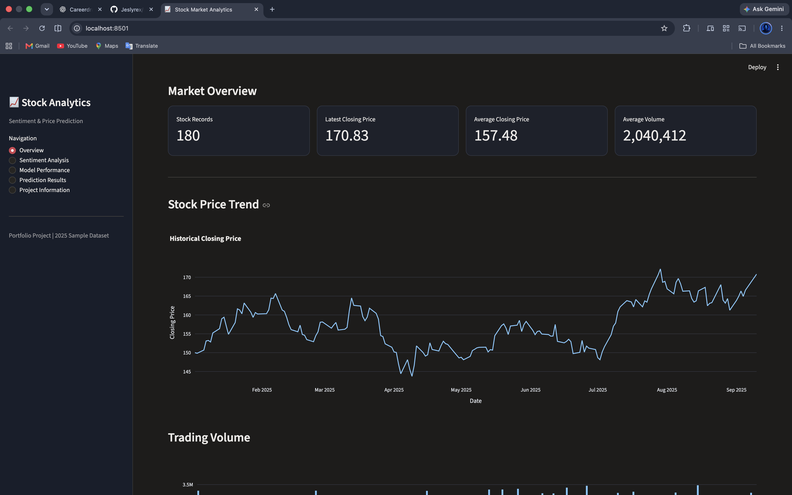
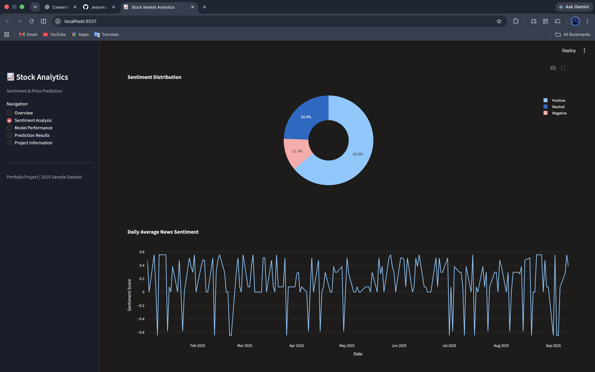
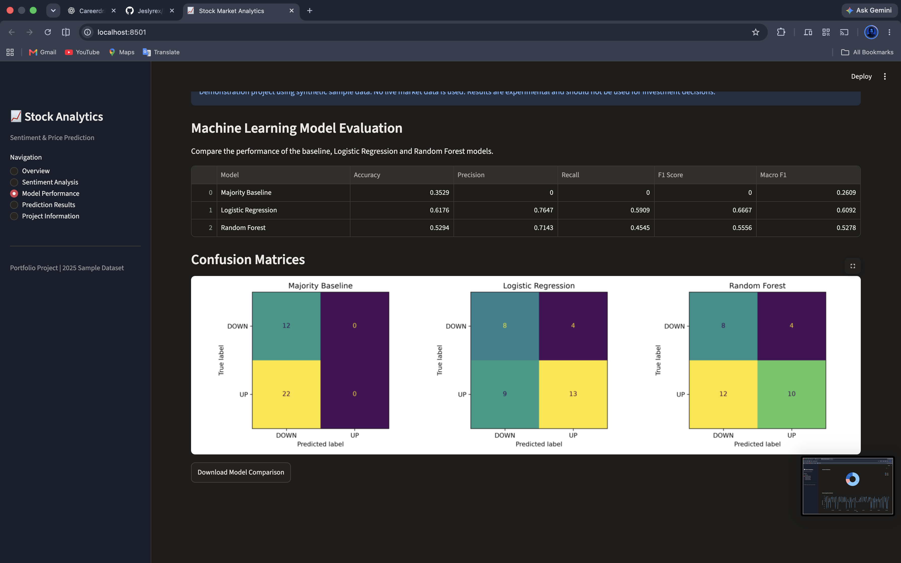
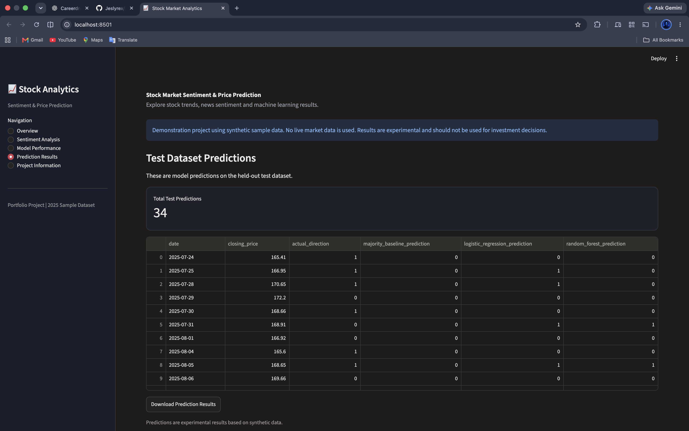

# Stock Market Sentiment & Price Prediction

An experimental Data Analytics and Machine Learning project that explores the relationship between stock price movements and financial news sentiment.

The project combines Python-based data analysis, VADER sentiment analysis, feature engineering, machine learning models, and an interactive Streamlit dashboard.

> **Important:** This project uses synthetic demonstration datasets, not real-time financial market data. Results are experimental and should not be used for investment decisions.

## Project Overview

The objective is to investigate whether financial news sentiment, combined with historical stock price indicators, can help classify the next observed stock price movement as UP or DOWN.

The project covers the complete analytics workflow, from data preprocessing and exploratory analysis to model evaluation and dashboard development.

## Key Features

- Stock price trend analysis
- Financial news sentiment analysis using VADER
- Data cleaning and preprocessing
- Feature engineering using technical indicators
- Time-series-aware training and testing
- Machine learning model comparison
- Confusion matrix visualization
- Interactive Streamlit dashboard
- Downloadable prediction and evaluation reports

## Technologies Used

| Technology | Purpose |
|---|---|
| Python | Programming and analysis |
| Pandas | Data manipulation |
| NumPy | Numerical operations |
| Matplotlib | Data visualization |
| Scikit-learn | Machine learning |
| VADER | News sentiment analysis |
| Plotly | Interactive charts |
| Streamlit | Dashboard development |

## Machine Learning Models

Three classification approaches were evaluated:

1. Majority Class Baseline
2. Logistic Regression
3. Random Forest Classifier

The models were evaluated using a chronological train-test split and TimeSeriesSplit cross-validation.

## Model Evaluation Results

### Holdout Test Performance

| Model | Accuracy | Precision | Recall | F1 Score |
|---|---:|---:|---:|---:|
| Majority Baseline | 35.29% | 0.00 | 0.00 | 0.00 |
| Logistic Regression | **61.76%** | 0.7647 | 0.5909 | 0.6667 |
| Random Forest | 52.94% | 0.7143 | 0.4545 | 0.5556 |

Logistic Regression achieved the highest accuracy on the held-out test dataset.

### Cross-Validation Results

| Model | Mean Accuracy | Mean Macro F1 |
|---|---:|---:|
| Majority Baseline | 50.00% | 0.3311 |
| Logistic Regression | 43.64% | 0.4159 |
| Random Forest | 48.18% | 0.4713 |

**Interpretation:** Holdout performance and cross-validation results differ. The small synthetic dataset makes the results unstable, and the models have not demonstrated reliable predictive performance on real financial data.

## Project Dataset

The project includes two synthetic demonstration datasets:

**1. Stock Price Dataset**
- Date
- Open
- High
- Low
- Close
- Volume

**2. Financial News Dataset**
- Date
- Headline
- Source

The datasets contain approximately 180 records each, covering January to September 2025.

The news dataset contains repeated sample headline templates. This limits the variety and realism of the sentiment analysis.

## Project Workflow

1. Load stock price and news datasets.
2. Inspect and preprocess the data.
3. Calculate financial news sentiment scores using VADER.
4. Engineer price and technical indicator features.
5. Create the next-observation UP/DOWN classification target.
6. Split the data chronologically into training and testing sets.
7. Train and evaluate machine learning models.
8. Compare model performance using multiple metrics.
9. Visualize results through an interactive Streamlit dashboard.

## Dashboard

The Streamlit dashboard contains five sections:

- **Overview:** Stock price trends, trading volume and daily returns.
- **Sentiment Analysis:** Positive, negative and neutral headline distribution.
- **Model Performance:** Model metrics and confusion matrices.
- **Prediction Results:** Held-out test predictions.
- **Project Information:** Project objectives, workflow and dataset details.

## Project Structure

```text
stock-market-sentiment-price-prediction/
│
├── app.py
├── README.md
├── requirements.txt
│
├── data/
│   ├── sample_stock_prices.csv
│   └── sample_news_headlines.csv
│
├── src/
│   └── train_model.py
│
├── outputs/
│   ├── model_comparison.csv
│   ├── test_predictions.csv
│   ├── cross_validation_results.csv
│   ├── model_comparison.png
│   ├── confusion_matrices.png
│   └── price_and_sentiment.png
│
└── backup/
    └── train_model_old.py
```

## How to Run the Project

### 1. Clone the repository

```bash
git clone https://github.com/Jeslyrex/data-analytics-projects.git
```

Navigate to the project directory:

```bash
cd stock-market-sentiment-price-prediction
```

### 2. Create a virtual environment

```bash
python3 -m venv .venv
```

Activate it on macOS:

```bash
source .venv/bin/activate
```

### 3. Install dependencies

```bash
pip install -r requirements.txt
```

### 4. Run model training

```bash
python src/train_model.py
```

### 5. Launch the dashboard

```bash
streamlit run app.py
```

The dashboard will normally open at:

```text
http://localhost:8501
```

## Limitations

- The datasets are synthetic and do not represent actual market activity.
- The news headlines contain repeated sample templates.
- The dataset is relatively small.
- Model performance varies between holdout testing and cross-validation.
- Results cannot be generalized to real-world stock markets.

## Future Improvements

- Integrate real historical stock market data.
- Collect diverse financial news headlines.
- Expand the dataset and testing period.
- Explore additional financial indicators.
- Investigate more robust time-series validation techniques.
- Evaluate model performance on unseen real-world data.
- Deploy the dashboard for public access.

## Author

**John Jasmith Vanganuru**

GitHub: [Jeslyrex](https://github.com/Jeslyrex)

---

*Developed as a Data Analytics and Machine Learning portfolio project.*


## Dashboard Preview

### 1. Dashboard Overview


### 2. Sentiment Analysis


### 3. Model Performance


### 4. Prediction Results

